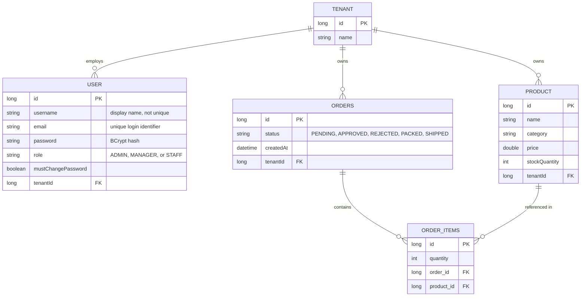
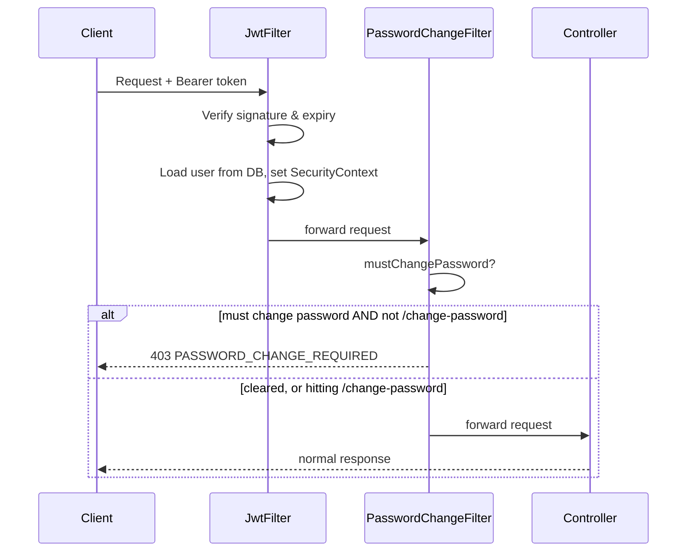
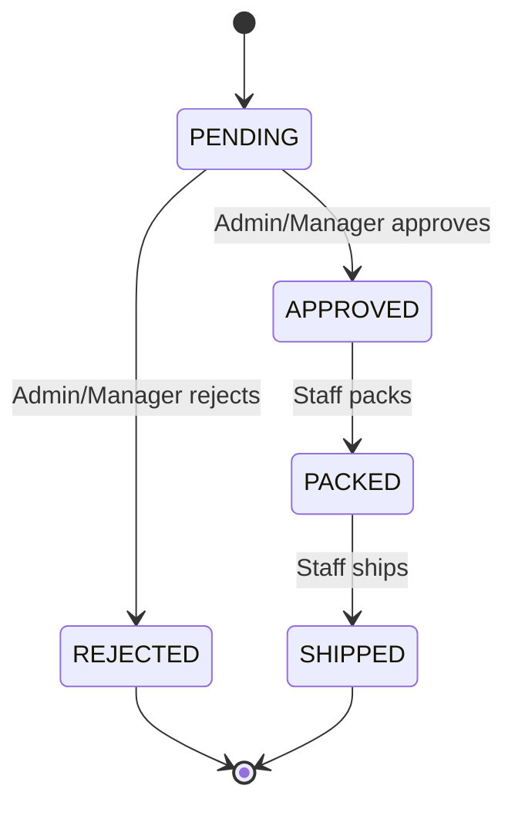

# StockFlow  Technical Documentation

A multi-tenant inventory and order management API built with Spring Boot, demonstrating JWT authentication, role-based access control (RBAC), invite-only onboarding, and SaaS-style multi-tenancy on a single shared database.

---

## Table of Contents

- [StockFlow  Technical Documentation](#stockflow--technical-documentation)
  - [Table of Contents](#table-of-contents)
  - [System Overview](#system-overview)
  - [Tech Stack](#tech-stack)
  - [Architecture](#architecture)
  - [Entity-Relationship Diagram](#entity-relationship-diagram)
  - [Data Model](#data-model)
  - [Authentication \& Onboarding Flow](#authentication--onboarding-flow)
  - [Role-Based Access Control](#role-based-access-control)
  - [Multi-Tenancy](#multi-tenancy)
  - [Order Workflow](#order-workflow)
  - [API Reference](#api-reference)
  - [Error Handling](#error-handling)
  - [Setup \& Configuration](#setup--configuration)
    - [Prerequisites](#prerequisites)
    - [Environment Variables](#environment-variables)
    - [Steps](#steps)
  - [Design Decisions \& Trade-offs](#design-decisions--trade-offs)
  - [Known Limitations \& Roadmap](#known-limitations--roadmap)

---

## System Overview

StockFlow lets multiple independent businesses ("tenants") manage their own product inventory and order fulfillment workflow through the same API and database, with strict data isolation between tenants and three distinct user roles per business.

Conceptually, it mirrors how platforms like Shopify or Slack operate: many customers share one running application and one database, but each customer's data is invisible to every other customer.

---

## Tech Stack

| Layer | Technology | Rationale |
|---|---|---|
| Language / Framework | Java 21, Spring Boot 4 | Industry-standard for enterprise backend APIs |
| Security | Spring Security, JJWT | Stateless auth suited to multi-client (web/mobile/desktop) consumption |
| Persistence | Spring Data JPA, PostgreSQL | Relational fit for inherently relational data (tenants → users/products/orders) |
| Validation | Jakarta Bean Validation | Declarative request validation, consistent error contracts |
| Build | Maven | — |

---

## Architecture

Layered architecture, organized by technical responsibility:

```
controller/   → HTTP request/response handling only
service/      → Business logic, tenant scoping, workflow rules
repository/   → Spring Data JPA interfaces
entity/       → Database models
dto/          → Request/response contracts, decoupled from entities
security/     → UserPrincipal (Spring Security adapter)
config/       → Security config, JwtFilter, PasswordChangeFilter
exception/    → Custom exceptions + centralized global handler
```

Each layer has exactly one responsibility: controllers never contain business logic, services never format HTTP responses, and tenant/permission enforcement lives in the service layer so it can never be bypassed by a controller that forgets to check.

---

## Entity-Relationship Diagram



**Reading the cardinality:** `||` means "exactly one," `o{` means "zero or many." So `TENANT ||--o{ USER` reads as "one Tenant has zero-or-many Users; each User belongs to exactly one Tenant." The foreign key always lives on the "many" side of the relationship (`tenantId` on `USER`, `PRODUCT`, and `ORDERS`).

`ORDER_ITEMS` is a **junction table** connecting `ORDERS` and `PRODUCT` in a many-to-many relationship (one order can contain many products; one product can appear on many orders), while also carrying data specific to that pairing `quantity` that belongs to neither side alone.

---

## Data Model

| Entity | Purpose |
|---|---|
| **Tenant** | The isolation boundary. Every business gets exactly one row here. |
| **User** | Belongs to exactly one Tenant, has exactly one Role. Unique by `email`; `username` is a non-unique display name. |
| **Product** | Belongs to exactly one Tenant. Tracks name, category, price, stock quantity. |
| **Order** | Belongs to exactly one Tenant. Header record holding status and timestamp. |
| **OrderItem** | Join table between Order and Product; captures quantity per line item. |

---

## Authentication & Onboarding Flow

1. **Tenant creation**: a business registers via `POST /api/auth/register-tenant`, creating its Tenant and first Admin user in a single request. The founding Admin chooses their own password.
2. **Inviting employees**: additional Manager/Staff accounts can only be created by an existing Admin, via `POST /api/auth/register`. This endpoint is protected by `@PreAuthorize("hasRole('ADMIN')")`, and the new user's `tenantId` is read from the requesting Admin's own authenticated session, never from the request body. There is no open self-registration into an existing tenant.
3. **Temporary credentials**: new accounts receive a system-generated, random temporary password (currently returned directly in the API response; email delivery is a planned enhancement).
4. **Forced password change**: every new account is flagged `mustChangePassword = true`. A dedicated servlet filter (`PasswordChangeFilter`) blocks access to every endpoint except `PUT /api/auth/change-password` until the flag is cleared.
5. **Login**: `POST /api/auth/login` authenticates by **email** (not username) and returns a signed JWT.
6. **Authenticated requests**: the client sends `Authorization: Bearer <token>` on every request. `JwtFilter` validates the token's signature and expiry, then loads the current user's tenant and role fresh from the database on each request (rather than trusting stale data baked into the token), so a deleted account or changed role takes effect immediately.



---

## Role-Based Access Control

Three roles exist per tenant: `ADMIN`, `MANAGER`, `STAFF`. Permissions are enforced with method-level `@PreAuthorize` annotations, backed by `@EnableMethodSecurity`.

| Action | Admin | Manager | Staff |
|---|---|---|---|
| View products/orders | ✅ | ✅ | ✅ |
| Create/update products | ✅ | ✅ | ❌ |
| Delete products | ✅ | ❌ | ❌ |
| Invite Manager/Staff accounts | ✅ | ❌ | ❌ |
| Approve/reject orders | ✅ | ✅ | ❌ |
| Create orders, mark packed/shipped | ✅ | ✅ | ✅ |

A logged-in user's role is carried inside `UserPrincipal` (the app's `UserDetails` implementation), read from the database via `MyUserDetailsService` on every request, not trusted from the JWT payload beyond identity.

---

## Multi-Tenancy

Every tenant-owned table (`users`, `products`, `orders`) carries a `tenantId` foreign key. Enforcement happens once, centrally, in each service:

- **On write**: `tenantId` is set automatically from the authenticated user's own token; a client can never specify which tenant a new record belongs to.
- **On read**: every query is filtered by the current user's `tenantId` (e.g., `findAllByTenantId`).
- **On single-resource lookup**: if a resource exists but belongs to a different tenant, the API returns `404 Not Found` identical to the resource not existing at all. This deliberately avoids leaking the existence of another tenant's data.

---

## Order Workflow



Stock is deducted at the **approval** step, not at order creation, inventory only commits once a Manager or Admin confirms the order can be fulfilled. Every transition validates the order's current status first (e.g., an order can't be shipped before it's packed, or approved twice), returning `409 Conflict` on an invalid transition.

---

## API Reference

| Method | Endpoint | Auth Required | Roles |
|---|---|---|---|
| POST | `/api/auth/register-tenant` | No | — |
| POST | `/api/auth/register` | Yes | Admin |
| POST | `/api/auth/login` | No | — |
| PUT | `/api/auth/change-password` | Yes | Any |
| GET | `/api/products` | Yes | Any |
| GET | `/api/products/{id}` | Yes | Any |
| POST | `/api/products` | Yes | Admin, Manager |
| PUT | `/api/products/{id}` | Yes | Admin, Manager |
| DELETE | `/api/products/{id}` | Yes | Admin |
| POST | `/api/orders` | Yes | Any |
| GET | `/api/orders` | Yes | Any |
| GET | `/api/orders/{id}` | Yes | Any |
| PUT | `/api/orders/{id}/approve` | Yes | Admin, Manager |
| PUT | `/api/orders/{id}/reject` | Yes | Admin, Manager |
| PUT | `/api/orders/{id}/pack` | Yes | Any |
| PUT | `/api/orders/{id}/ship` | Yes | Any |

---

## Error Handling

A centralized `@RestControllerAdvice` (`GlobalExceptionHandler`) maps exceptions to consistent HTTP responses:

| Exception | Status | Meaning |
|---|---|---|
| `ProductNotFoundException` | 404 | Product doesn't exist, or belongs to another tenant |
| `OrderNotFoundException` | 404 | Order doesn't exist, or belongs to another tenant |
| `UserAlreadyExistsException` | 409 | Username/email/tenant name already taken |
| `InvalidCredentialsException` | 401 | Login failed, or current password incorrect on change-password |
| `InvalidOrderStateException` | 409 | Requested order transition isn't valid from its current status |
| `AccessDeniedException` | 403 | Authenticated, but role lacks permission for this action |
| `MethodArgumentNotValidException` | 400 | Request body failed validation (with per-field messages) |

---

## Setup & Configuration

### Prerequisites
- Java 21+
- PostgreSQL
- Maven

### Environment Variables

| Variable | Purpose |
|---|---|
| `JWT_SECRET` | Signing key for JWTs. Long, random string — never committed to source control. |
| `JWT_EXPIRATION` | Token lifetime in milliseconds. |

### Steps

```sql
CREATE DATABASE stockflow;
```

```bash
./mvnw spring-boot:run
```

The API runs at `http://localhost:8080`.

---

## Design Decisions & Trade-offs

- **`ddl-auto=update` in development only.** It only ever adds tables/columns/constraints, never modifies or drops them — which caused real migration friction during development (e.g., a stale unique constraint on `username` survived an entity change until manually dropped). A production deployment would use a proper migration tool (Flyway/Liquibase) instead.
- **Email as identifier, username as display name.** Initially both were unique, which incorrectly prevented two different people from sharing a display name. Splitting "login identity" (email) from "display name" (username) matches how most real systems work.
- **Stateless JWT, with a DB read on every request.** Full statelessness would mean trusting the token's payload entirely; instead, `JwtFilter` re-fetches the user's current data on each request so a role change or account deletion takes effect immediately, at the cost of one DB read per request.
- **No refresh tokens / server-side logout yet.** A pure stateless JWT has no true logout, a token remains valid until it expires. A production system would add refresh tokens and a revocation list (commonly Redis-backed).
- **Filters over per-method checks for cross-cutting concerns.** JWT validation and the forced password-change gate are implemented as servlet filters, not checks repeated inside every controller/service method, keeping business logic focused solely on its own feature.

---

## Known Limitations & Roadmap

- [ ] API versioning (`/api/v1/` path prefix)  not yet applied
- [ ] Email delivery for invite-based onboarding (temporary password currently returned directly in the API response)
- [ ] Payment integration (Stripe):  a `PAYMENT_PENDING` / `PAID` state between order approval and fulfillment
- [ ] Pagination and search/filter on product and order listings
- [ ] Automated tests (unit + integration): none exist yet
- [ ] Companion Compose Multiplatform frontend (Android, iOS, Desktop)